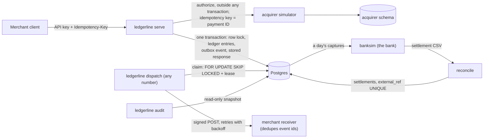

# Ledgerline

A payments API and double-entry ledger in Go, built to show that money stays correct when
things go wrong: concurrent requests on one payment, clients that retry, and processes killed
mid-write. Amounts are integers in minor units everywhere. Postgres itself rejects unbalanced
journal entries. Every POST is idempotent, including the one that calls the card network.
Webhooks go out through a transactional outbox, and the books are reconciled against the bank's
settlement file. Each of those claims is backed by a test that fails when the guarantee breaks,
and [docs/INVARIANTS.md](docs/INVARIANTS.md) lists the deliberately broken builds each key test
was shown to catch.

## Quickstart

Needs Docker (Compose v2), `curl` and `jq`.

```sh
docker compose up -d --build --wait serve dispatch   # Postgres, migrations, the API on :8080, the webhook dispatcher
KEY=$(docker compose run --rm -T serve merchant create -name "Demo Shop" | jq -r .api_key)
H=(-H "Authorization: Bearer $KEY" -H "Content-Type: application/json")

PID=$(curl -s "${H[@]}" -X POST localhost:8080/v1/payments -H "Idempotency-Key: order-1001" \
  -d '{"amount": 2500, "currency": "USD", "customer_id": "cus_42",
       "card": {"fingerprint": "fp_visa_4242", "country": "US"}, "ip_country": "US"}' | jq -r .id)

curl -s "${H[@]}" -X POST localhost:8080/v1/payments/$PID/authorize -H "Idempotency-Key: auth-1001"
curl -s "${H[@]}" -X POST localhost:8080/v1/payments/$PID/capture   -H "Idempotency-Key: cap-1001"   # fee 103
curl -si "${H[@]}" -X POST localhost:8080/v1/payments/$PID/capture  -H "Idempotency-Key: cap-1001"   # Idempotent-Replayed: true
curl -s "${H[@]}" -X POST localhost:8080/v1/payments/$PID/refunds   -H "Idempotency-Key: ref-1001" -d '{"amount": 1000}'
curl -s "${H[@]}" localhost:8080/v1/payments/$PID/ledger | jq '.data[] | {kind, entries: [.entries[] | {account, amount}]}'
docker compose run --rm -T serve audit                                                                 # AUDIT PASSED
```

The fee on a $25.00 capture is 2.9% (72.5, rounded half up to 73) + 30 = 103 cents. Replaying a
key returns the stored response byte for byte. Capturing again with a new key gets
`409 invalid_state_transition`. Every endpoint and error code is in [docs/api.md](docs/api.md).

## Architecture



- **One transaction per state change.** A capture, refund or void locks the payment row and
  applies the state machine. In the same commit it writes the ledger entries, the outbox event
  and the stored idempotent response. A crash before COMMIT leaves nothing behind
  ([ADR 0003](docs/adr/0003-locking.md), [ADR 0004](docs/adr/0004-idempotency.md)).
- **Authorize** is the one external call. It runs as three phases with recovery points, and
  sends our payment ID as the acquirer's idempotency key, so a retry after a crash cannot
  authorize twice.
- **The database enforces the ledger:**
  - deferred constraint triggers reject unbalanced or single-entry journal transactions at COMMIT
  - entries, journal transactions, refunds and events are append-only
  - a composite foreign key ties each entry's currency to its account's
- **Webhooks** are written to an outbox in the same transaction as the change, and delivered
  at-least-once by any number of dispatchers. Receivers dedupe on the event id
  ([ADR 0005](docs/adr/0005-outbox.md)).

## Invariants

The full table, with every test, is in [docs/INVARIANTS.md](docs/INVARIANTS.md).

| Invariant | Enforced by | Proven by |
|-----------|-------------|-----------|
| Every journal transaction has ≥ 2 entries and sums to 0 per currency, checked at COMMIT | DB deferred triggers + Go validation | `TestSchemaBalanceIsCheckedAtCommit`, `TestPropLedgerPostgres` |
| The ledger is append-only (UPDATE, DELETE, TRUNCATE all raise) | DB triggers | `TestSchemaIsAppendOnly` |
| refunded ≤ captured ≤ authorized; each status implies its amounts | DB CHECKs + state machine | `TestPaymentsSchemaChecks`, `TestPropPaymentsAPI` |
| Only transitions in the event table are possible (every (from, to) and (event, from) pair) | Go transition table | `TestTransitionTable`, `TestEventTable`, `TestAPIStateMachineEveryStateAndOperation` |
| 100 concurrent captures with different keys ⇒ exactly one capture | `SELECT … FOR UPDATE` | `TestConcurrencyCaptureDifferentKeys` (25 runs, `-race`) |
| Same key + same request ⇒ the stored bytes, without executing again; a different request ⇒ 409 | Idempotency keys (SHA-256 of canonical request) | `TestAPIIdempotency`, `TestConcurrencyCaptureSameKey`, `TestConcurrencyReplaysOfFinishedKey` |
| Parallel refunds never exceed the capture | Row lock (the CHECK alone did *not* catch it, see ADR 0003) | `TestConcurrencyOverRefund` |
| A retried authorization is never authorized twice at the network | Payment ID as the acquirer's idempotency key | `TestAuthorizeTimeoutThenRetry`, `TestChaos` |
| Exactly one outbox event per committed change; each delivered at least once; processed once | Outbox in the same transaction; SKIP LOCKED + lease; receiver dedupe | `TestOutboxEventOnlyWithCommit`, `TestDispatchManyDispatchersNoDoubleSend`, `TestChaos` |
| Balances equal an independent reference model after every random operation | n/a (this is the check) | `TestPropLedgerMemory`, `TestPropPaymentsPure` (≥ 1M operations each) |
| Reconciliation finds every injected bank fault with no false positives, and never double-posts | Pure reconciler; UNIQUE `external_ref` | `TestReconcileMatchesManifestAcrossSeeds`, `TestReconcileAgainstLedger` |

## Tests

From runs on an Apple M2 (8 cores, 8 GB) with Go 1.27.4 and Postgres 17.12. Property-test
operation counts vary from run to run because rapid picks a fresh seed each time.

| Suite | Command | Result |
|-------|---------|--------|
| Unit | `make test` | 65 tests, 160 subtests, 0 failures |
| Integration (real Postgres) | `make test-integration` | 62 tests, 71 subtests, 0 failures, 58.9s |
| Concurrency acceptance | `make test-concurrency` | 25/25 passes for each of the 4 tests under `-race`, 30.3s |
| Chaos: SIGKILL at 3 failpoints and at random | `make chaos CHAOS_COUNT=3` | 3/3 passed; per run 86–99 failpoint kills, 16–19 random kills, 853–880 events, 225–330 duplicate deliveries deduped |
| Property: ledger, in-memory | `make prop-long` | 1,513,623 operations in 21.2s |
| Property: payment lifecycle, in-memory | `make prop-long` | 1,503,481 operations in 2.7s |
| Property: ledger and payment lifecycle on Postgres (over HTTP) | integration suite | ~3,000 operations each, audits after every step |
| Reconciliation vs bank manifest | `go test ./internal/recon` | 2,000 seeds, 45,217 injected faults, all found, 0 false positives |
| Fraud rules on public datasets (held-out split) | `scripts/download-datasets.sh && go run ./cmd/fraudeval` | Sparkov: precision 0.317, recall 0.412, F1 0.358 at a 0.50% flag rate (base rate 0.386%). ULB (amount rule only): F1 0.008. [Report](docs/fraud-eval.md) |

## Benchmarks

k6 on the same laptop as the stack, 30 s constant-arrival-rate runs, stock Postgres settings.
The full method, all rates, and the bottleneck analysis are in [docs/benchmarks.md](docs/benchmarks.md).

| Scenario | Holds at | p50 / p95 / p99 (ms) at that rate | Breaks at | Bottleneck |
|----------|----------|------------------------------------|-----------|------------|
| Full flow (create → authorize → capture), pool 8 | 400 flows/s (~1,180 req/s) | create 1.8 / 66 / 126; authorize* 86 / 167 / 252 | 400–600 flows/s | The 8-connection pool: all connections busy, CPU under half. With pool 32 it holds 800 flows/s |
| Full flow, pool 32 | 800 flows/s (~2,360 req/s) | create 59 / 233 / 319; authorize* 172 / 452 / 566 | 800–1,000 flows/s | WAL commit contention plus the shared laptop CPU |
| Idempotent replays | 3,000 req/s (no break found) | 0.4 / 8.0 / 79 | > 3,000 req/s | Not reached |
| Refunds on one hot payment | 400 req/s | 1.9 / 332 / 419 | 400–600 req/s | The payment's row lock (by design) |

\* Authorize includes the simulated acquirer's 50–100 ms latency.

The replay scenario **found a bug** before it was fixed. Concurrent replays of a *finished* key
could get `409 idempotency_key_in_use`, because every request took the key's lock before reading
the stored response. Finished responses are now read without the lock (commit `b963ae4`, with a
regression test).

## Development

```sh
make test               # unit tests with -race (no Docker)
make test-integration   # Postgres via testcontainers (needs Docker)
make test-concurrency   # the concurrency acceptance tests, 25 runs each with -race
make chaos              # SIGKILL serve/dispatch/receiver at failpoints and at random, then check everything
make prop-long          # >= 1,000,000 generated operations each for the ledger and the payment lifecycle
make load               # k6: full flow, replays, hot payment, stepped through rising rates (needs k6)
make lint               # go vet with every build tag + golangci-lint
make audit              # ledger + payments-vs-ledger invariants in $DATABASE_URL; exits 1 on any violation
```

Requires Go 1.27+ and Docker. `make lint` needs golangci-lint v2 and `make load` needs k6.
CI runs lint, unit, integration, the concurrency tests (25 runs) and the chaos test (3 runs) on
every push.

## Docs

- [docs/api.md](docs/api.md): endpoints, state machine, errors, fees, fraud verdicts, test card fingerprints
- [docs/ledger.md](docs/ledger.md): accounts, postings, a worked example (checked by `go test`), why authorization posts nothing
- [docs/webhooks.md](docs/webhooks.md): delivery guarantees, verifying signatures, rotation, retries
- [docs/reconciliation.md](docs/reconciliation.md): settlement file, classification, idempotent posting, a real run
- [docs/fraud-eval.md](docs/fraud-eval.md): fraud rules evaluated on two public datasets (generated by `cmd/fraudeval`)
- [docs/benchmarks.md](docs/benchmarks.md): k6 results, breaking points, the measured bottleneck
- [docs/INVARIANTS.md](docs/INVARIANTS.md): invariant → how it is enforced → the test that proves it → the bug it caught
- [docs/adr/](docs/adr/): signed amounts, fees on refunds, locking, idempotency, outbox
- [docs/go-notes.md](docs/go-notes.md): Go idioms explained for a C++ programmer

## Layout

| Path | Contents |
|------|----------|
| `cmd/ledgerline` | Main binary: `serve`, `dispatch`, `merchant create`, `migrate`, `audit` |
| `cmd/receiver` | Sample merchant webhook endpoint: verifies signatures, dedupes event ids |
| `cmd/banksim`, `cmd/reconcile` | Bank settlement file with seeded faults + manifest; reconciliation and posting |
| `cmd/fraudeval` | Replays fraud datasets through the rules and writes the report |
| `internal/api` | HTTP routing, auth, errors, idempotent transactions, the phased authorize |
| `internal/payments` | State machine, domain operations, pricing, SQL, payments-vs-ledger audit |
| `internal/idempotency` | Request fingerprints, key store, advisory locks, fencing tokens |
| `internal/acquirer` | Card-network interface and the simulator |
| `internal/ledger` | Chart of accounts, posting builders, validation, in-memory and Postgres ledgers, audit |
| `internal/webhooks` | Outbox, endpoints, signing, dispatcher, the receiver's handler |
| `internal/fraud` | Pure fraud rules (signals + thresholds), JSON config, tuned defaults |
| `internal/recon` | Settlement files, the bank simulator, the pure reconciler, idempotent posting |
| `internal/money`, `internal/id`, `internal/store`, `internal/merchants` | Money type, prefixed IDs, pgx pool + migrations, API keys |
| `internal/failpoint` | Crash points, compiled in only with the `chaos` build tag |
| `internal/*/…test` | Stateful property-test machines shared by the pure and Postgres runs |
| `migrations/` | SQL migrations, embedded into the binary |
| `test/integration`, `test/chaos`, `loadtest/` | Postgres tests, the crash test, k6 scenarios |

## Not implemented / what I'd do next

In order of what I would do first:

1. **A completer for abandoned authorizations.** If a client never retries after a crash in
   the middle of an authorization, the payment stays `created` while the network holds the funds.
   A background worker should drive stale `started` keys to completion, using the same recovery
   path a retry uses.
2. **Fewer round trips per transaction.** `ClientRead` was the largest wait under load. Batching
   each state change's statements (`pgx.Batch` or one CTE), and sizing the pool to Postgres
   rather than to the app, would raise the full-flow limit. A bigger pool alone already doubled
   it.
3. **Refund settlement lines and cross-day reconciliation.** Today refunds leave
   `processor_receivable` negative, and a late row is only matched within its own capture day's
   file.
4. **Security hardening:**
   - encrypt webhook secrets with a KMS key
   - check webhook URLs against private address ranges (SSRF)
   - give the app a database role with only INSERT/SELECT on ledger tables, so the triggers
     can't simply be disabled
   - API-key rotation and rate limiting
5. **Operational visibility:** request IDs, metrics (pool waits, delivery lag, dead deliveries)
   and an exception queue for reconciliation mismatches and fraud reviews.
6. **Payments features:**
   - multiple partial captures
   - voiding at the acquirer
   - fixed fees per currency instead of one minor-unit figure
   - webhook endpoints that can be disabled or deleted
   - `LISTEN/NOTIFY` to wake dispatchers instead of polling
7. **A better fraud model.** The rules reach precision 0.317 on synthetic data, and the ULB data
   needs a learned model over its PCA features. Default thresholds exist only for USD. Country
   mismatch could not be evaluated on either dataset.

Also known: journal transactions are not sealed against a balanced late append
([details](docs/ledger.md#known-gaps)); nothing collects from a merchant whose balance is
negative; the currency table is a curated subset of ISO 4217 (28 codes).
